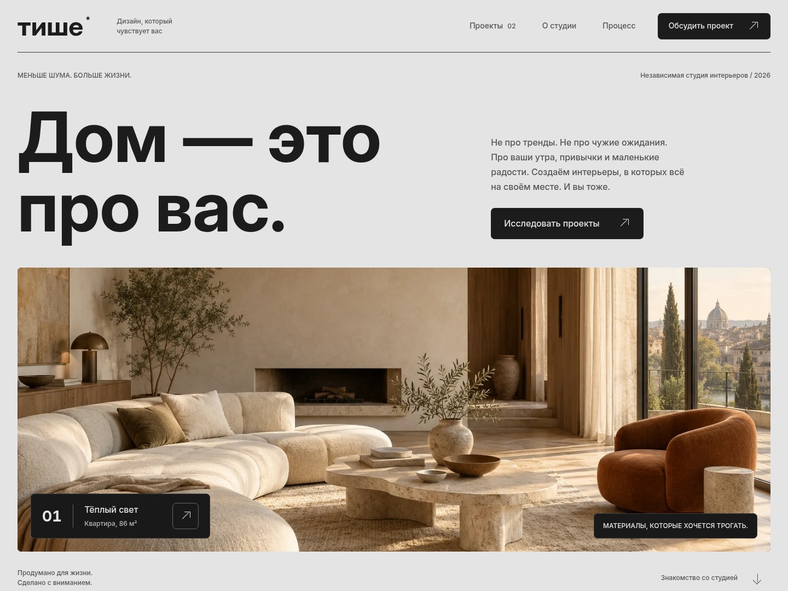

# ТИШЕ — пространство для жизни

Авторский лендинг вымышленной студии интерьеров. Текущая версия переработана по навыку [`awwwards-ui-skills`](https://github.com/ihlamury/design-skills/tree/main/skills/awwwards): монохромная дизайн-система, крупная типографика Inter и галерея интерьеров.



### Дизайн-направление

Фон `#E4E4E4`, тёмные поверхности `#2F2E30` и `#191919`, один локальный шрифт Inter. Главный заголовок — 127 px / 700 на базовом экране 1920 px; текст — 16 px / 500. Для планшетов и телефонов размеры адаптируются. Отступы построены на сетке 4 px, основные скругления — 7 px, границы — 1 px. Для заголовков используется `text-wrap: balance`, для абзацев — `text-wrap: pretty`; числовые подписи набраны табличными цифрами. Межбуквенный интервал не изменён.

Первый экран соединяет заголовок «Дом — это про вас», краткое описание и панорамный интерьер. Тёмные карточки собирают проекты в строгую галерею, а нумерованные блоки раскрывают подход и процесс работы. Анимаций нет; состояния наведения и фокуса меняются сразу. Фокус обозначен обводкой `#5E6AD2` толщиной 2 px с отступом 2 px.

Часть исходных токенов навыка адаптирована ради доступности: светло-серый вторичный текст используется только на тёмных поверхностях, а на светлом фоне — более тёмный. Указанная в навыке нулевая высота полей не применена: у полей остаётся минимальная высота 48 px для удобного ввода. Проект вдохновлён ограничениями навыка и не заявляет о получении наград Awwwards.

Внешние компонентные референсы и 21st.dev не использовались. Сохранён существующий стек HTML/CSS/JavaScript без дополнительных runtime-зависимостей.

## Идея и реализация

Задача — показать характер небольшой дизайн-студии и провести посетителя от знакомства с подходом до подготовки своего проекта. Вместо вымышленных отзывов и неподтверждённых цифр — два концептуальных интерьера, понятные этапы работы и полезный интерактивный бриф.

- Адаптивная верстка для телефона, планшета и компьютера.
- Карточки проектов с фильтрами по типу пространства и подробностями в модальных окнах.
- Раскрывающиеся этапы работы, FAQ, мобильное меню и якорная навигация.
- Бриф с валидацией и скачиванием `.txt` в UTF-8.
- Семантическая разметка, переход к основному содержимому, видимый фокус, клавиатурное управление и поддержка `prefers-reduced-motion`.
- Локальные WOFF2-шрифты и WebP-изображения. Никаких CDN, аналитики или cookies.
- SEO-метаданные, Open Graph и собственный SVG-фавикон.

**Стек:** HTML5, CSS3, JavaScript; Node.js используется только для сервера разработки, сборки и проверок. Runtime-зависимостей и шага установки пакетов нет.

## Запуск

Требуется **Node.js 22+**. Если используете nvm: `nvm use`.

```sh
npm run dev
```

Откройте `http://localhost:3000`. Другой порт: `PORT=8080 npm run dev` (Bash). Остановить сервер: `Ctrl+C`.

## Проверки и сборка

```sh
npm run check   # Проверка синтаксиса JavaScript
npm test        # Ресурсы, якоря, HTTP-ответы и недоступность служебных файлов
npm run build   # Чистая сборка в dist/
npm run preview # Локальный просмотр собранного сайта
```

Для воспроизводимой проверки интерфейса запустите сервер в одном терминале, а в другом выполните:

```sh
python -m pip install playwright
python -m playwright install chromium
python scripts/browser-check.py
```

Это необязательные инструменты разработки; для работы сайта Python и Playwright не нужны. Скрипт проверяет адаптивность, фильтры, меню, раскрывающиеся секции, диалоги, валидацию и содержимое скачанного брифа. Можно указать адрес собранного сайта: `python scripts/browser-check.py --url http://localhost:3001`.

Проверки синтаксиса, ресурсов и HTTP, а также сборка настроены в GitHub Actions для push и pull request. При разработке сайт дополнительно проверен в Chromium на ширинах 320, 390, 768, 1024, 1440 и 1920 px: без горизонтального переполнения, с рабочими фильтрами, диалогами, возвратом фокуса, аккордеонами, меню и скачиванием брифа. Автоматические браузерные проверки в CI не включены. Проверка axe-core по правилам WCAG A/AA не обнаружила нарушений в проверенных состояниях страницы, диалогов и мобильного меню; это не заменяет полный ручной аудит доступности.

## Публикация

Результат `npm run build` — автономная папка `dist/`. Её можно разместить на любом статическом хостинге. Например, в Cloudflare Pages или Netlify задайте команду сборки `npm run build` и выходной каталог `dist`. Для GitHub Pages загрузите содержимое `dist` через Pages workflow. Относительные пути поддерживают размещение в подпапке.

Перед публичным коммерческим запуском замените демонстрационные тексты реальными данными студии, задайте абсолютный URL для `og:image` и добавьте `og:url` после выбора домена. Автоматическая публикация в этом репозитории не настроена.

## Структура

```text
index.html             Секции, навигация, диалоги и форма
styles.css             Дизайн-система и адаптивные стили
app.js                 Меню, проекты, диалоги и генерация брифа
assets/                Изображения, шрифты, иконки и лицензии
docs/preview.jpg       Скриншот первого экрана
scripts/server.mjs     Локальный HTTP-сервер
scripts/build.mjs      Сборка статических файлов
scripts/site.test.mjs  Проверки ресурсов и HTTP
scripts/browser-check.py  Функциональные проверки в Chromium (опционально)
```

Цвета и базовые настройки находятся в CSS-переменных `:root`. Описания проектов — в массиве `projects` файла `app.js`.

## Границы демонстрации и лицензии

ТИШЕ — вымышленная студия. Интерьеры — оригинальные AI-визуализации, а не фотографии реализованных объектов. Коммерческие услуги через сайт не оказываются.

Форма **не отправляет заявку**: она создаёт файл брифа в браузере. Нет backend, базы данных, почтовой рассылки или сохранения персональных данных. Это прямо указано в форме и в диалоге конфиденциальности. Для реального приёма заявок понадобятся серверная интеграция и соответствующие правила обработки данных.

Код распространяется по [MIT](LICENSE). Шрифт [Inter](https://github.com/google/fonts/tree/main/ofl/inter) — по SIL Open Font License 1.1; оригинальная лицензия находится в `assets/Inter-OFL.txt`.
